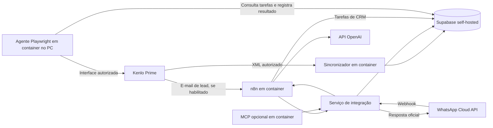

# Plano de implementação

## Objetivo e escopo

Construir uma camada própria sobre o Kenlo Prime para receber contatos, encontrar imóveis reais, atender no WhatsApp e, gradualmente, registrar informações no CRM. O Kenlo continua sendo a fonte de verdade para imóveis e atendimentos; o Supabase mantém uma cópia de consulta e os dados operacionais da integração. Essa camada não é uma API oficial do Kenlo.

**MVP:** importar um catálogo autorizado, receber mensagens pelo WhatsApp oficial, extrair preferências, consultar imóveis reais e sugerir respostas sob supervisão. Encaminhar a conversa ao corretor. A atualização automática no Kenlo entra somente após validar o fluxo e o piloto supervisionado. Nenhum imóvel deve ser anunciado como disponível sem indicar a data da última atualização e, antes de avançar na negociação, confirmar sua disponibilidade.

## Decisões iniciais

- **Banco:** Supabase self-hosted em containers, conforme o requisito de manter a infraestrutura própria em containers. Usar a distribuição oficial e versões fixadas. Isso traz responsabilidade de backups, atualizações, monitoramento, armazenamento e recuperação. Como alternativa a decidir, Supabase gerenciado reduz a operação, mas o banco deixaria de rodar em containers sob nosso controle.
- **WhatsApp:** integração direta com a WhatsApp Business Platform Cloud API oficial. O aplicativo WhatsApp Business, por si só, não é a integração programática; será necessário configurar conta empresarial, número, credenciais, webhook e as condições exigidas pela Meta. Evolution API fica fora do MVP: avaliar apenas se trouxer benefício concreto e estiver usando o provedor oficial.
- **IA:** utilizar a API OpenAI com faturamento e limites próprios. ChatGPT Pro e a plataforma de API têm faturamento separado; não presumir que a assinatura cubra as chamadas da automação. Validar modelo, custo, política de dados e limites antes do piloto. "App-serve" é ambíguo: investigar se significa Codex app-server, Apps SDK ou outro produto; não depender dele até comprovar adequação, licença e limites para atendimento contínuo. MCP é uma opção para consulta por um cliente compatível, não requisito da conversa no WhatsApp.
- **Orquestração:** n8n self-hosted para eventos, agendamentos e encaminhamento. Código de domínio, validação, deduplicação e integrações em serviços próprios; persistência do n8n separada dos dados de negócio. Proteger e preservar sua chave de criptografia.
- **Agente Kenlo:** Playwright em container no computador autorizado, com sessão protegida e controle de acesso. A viabilidade de autenticação, navegador, MFA e modo de execução no computador deve ser comprovada; o container não garante acesso à sessão de um navegador do host. Não contornar CAPTCHA ou MFA.

## Arquitetura proposta

Hospedar serviços próprios em containers com rede privada, TLS na entrada, volumes persistentes, segredos fora do Git, verificações de saúde e reinício controlado. O WhatsApp Cloud e a API OpenAI são serviços externos, portanto não rodam nos nossos containers. O agente local só funciona quando o computador está ligado, conectado e autenticado. O desenho de acesso à fila deve ser definido na implementação: o diagrama não implica expor o banco ou fornecer chaves privilegiadas ao agente.

### Dados e segurança

Entidades iniciais: imóveis, execuções de sincronização, leads e identidades de origem, preferências, conversas e mensagens, consentimentos e opt-out, tarefas de CRM e trilha de auditoria. Chaves únicas por origem e identificadores dos provedores previnem duplicações. Separar schemas internos dos dados acessíveis por API; aplicar privilégios mínimos, RLS às tabelas expostas e políticas testadas por perfil. Chaves privilegiadas somente no servidor. Registrar informações mínimas necessárias; definir bases legais, acesso, retenção, exclusão e transferência de dados conforme LGPD com responsável apropriado. Logs não devem conter tokens nem conversas completas por padrão.

## Fluxos e critérios técnicos

1. **Catálogo:** confirmar com Kenlo disponibilidade contratual, autorização, formato, abrangência e frequência do feed GaiaWebService/XML. Importar em área temporária, validar estrutura e volume, normalizar moeda/cidade/características e atualizar por identificador estável. Somente desativar imóveis ausentes após carga completa e válida; manter a última versão boa em caso de erro. Registrar origem e horário da última sincronização e alertar quando estiver desatualizada.
2. **WhatsApp:** validar assinatura do webhook e verificação inicial; confirmar evento rapidamente e processar de forma assíncrona. Deduplicar por ID do provedor, aplicar tentativas limitadas e guardar falhas para análise. Atender as regras vigentes de consentimento, opt-out, janela de atendimento e templates aprovados, especialmente para contato iniciado pela empresa. Conferir preços atuais da Meta antes do piloto.
3. **IA e busca:** extrair dados estruturados e validá-los antes do uso. Buscar por filtros determinísticos no banco; a IA só recomenda resultados reais retornados pela busca, sem inventar preço, atributos ou disponibilidade. Na ausência de resultados ou com catálogo desatualizado, informar a limitação e encaminhar ao corretor. Medir custo, falhas e qualidade com dados de teste.
4. **Leads por e-mail:** se o Kenlo disponibilizar esse recurso na conta, ingerir caixa dedicada, validar remetente/formato e usar identificador da mensagem/origem para evitar repetição. Não disparar WhatsApp proativo sem atender às regras aplicáveis e registrar a permissão.
5. **CRM:** criar tarefas autenticadas com identificador idempotente, prazo de processamento, tentativas limitadas e auditoria. Primeiro testar leitura e, depois, escrita com aprovação humana em ambiente de testes. Antes de atualizar, conferir identidade e estado atual; após gravar, reler e verificar resultado. Se a gravação tiver resultado incerto, reconciliar no Kenlo antes de tentar novamente. Sessão expirada, MFA, CAPTCHA ou mudança de interface interrompem o fluxo e geram alerta.
6. **MCP opcional:** funções somente de leitura para buscar e detalhar imóveis, com autenticação, autorização e limites. Conectar ao ChatGPT ou outro cliente somente após validar compatibilidade e condições vigentes; ações de escrita não fazem parte do primeiro MCP.

## Etapas e marcos

Estimativa inicial para uma pessoa desenvolvedora experiente, com acessos liberados e dedicação integral; não é prazo contratado. Dependências externas e validação operacional podem ampliar o calendário.

| Etapa | Estimativa | Entrega e condição para avançar |
| --- | --- | --- |
| 0. Descoberta | 3–5 dias úteis | Conta e regras da Meta verificadas; autorização Kenlo, XML e e-mail confirmados ou alternativas decididas; fluxo e critérios de aceite registrados. |
| 1. Base e catálogo | 1–2 semanas | Containers, Supabase e n8n instalados em ambiente de teste; backup restaurado; catálogo importado, rastreável e protegido contra carga incompleta. |
| 2. Busca e atendimento | 2–3 semanas | Webhook e busca reais em ambiente de teste; atendimento supervisionado, opt-out e transferência ao corretor; sem recomendações inventadas. |
| 3. Leads e piloto | 1–2 semanas | Ingestão autorizada, deduplicação, indicadores e piloto com contatos de teste, seguido por grupo limitado após validação humana. |
| 4. Agente Kenlo | 2–4 semanas | Leitura validada, depois gravação supervisionada e reconciliável; piloto de atualização em dados de teste antes do uso real. |
| 5. Operação | 1 semana | Monitoramento, restauração, documentação, suporte e plano de retorno testados. |

Total sequencial indicativo: **7–13 semanas**, sujeito à descoberta. Fases podem sobrepor-se se houver equipe e acessos. O MVP supervisionado pode ser alcançado antes do agente de escrita, desde que as integrações essenciais sejam liberadas.

## Testes e operação

- Testes automatizados de normalização do XML, filtros, duplicações, regras de estado e políticas de acesso; testes de integração com eventos de exemplo e contratos dos provedores.
- Simular webhook duplicado, mensagem fora de ordem, indisponibilidade da IA, XML inválido/incompleto, queda do banco e sessão Kenlo expirada. Garantir resposta segura e nenhuma gravação repetida sem reconciliação.
- Testar restauração de backup em ambiente separado, atualização de containers e retorno à versão anterior. Definir responsáveis e tempos de recuperação antes da produção.
- Indicadores: idade da última carga válida, mensagens recebidas/processadas, falhas e duplicações, tempo de primeira resposta, transferências, imóveis sugeridos com dados válidos, tarefas CRM pendentes e custo por conversa. Definir metas com o negócio após medir o piloto.
- Liberação gradual: teste interno → piloto supervisionado → expansão limitada. Manter opção de pausar a IA e o agente e devolver o atendimento ao corretor.

## Custos e decisões pendentes

Custos recorrentes incluem servidor/armazenamento/backups, operação do Supabase self-hosted e n8n, mensagens da Meta, chamadas da API OpenAI, domínio e monitoramento. Sem volume de mensagens, tamanho do catálogo, disponibilidade exigida e configuração da Meta não há estimativa confiável. Fazer orçamento com cenário de baixo, médio e alto volume e estabelecer limites de consumo.

Validar com responsáveis: titular e uso do número WhatsApp; consentimento e templates; liberação e cobertura do XML e dos e-mails; permissão de RPA e campos efetivos do CRM; responsável por revisão, retenção e suporte; significado de app-serve; infraestrutura e metas de disponibilidade; autorização para acessar dados reais.

## Fontes para verificar na implementação

- [Supabase self-hosting com Docker](https://supabase.com/docs/guides/self-hosting/docker)
- [Supabase: proteção da API](https://supabase.com/docs/guides/api/securing-your-api)
- [WhatsApp Cloud API](https://developers.facebook.com/docs/whatsapp/cloud-api/)
- [Política da WhatsApp Business Platform](https://www.whatsapp.com/legal/business-policy/)
- [Faturamento do ChatGPT e da API](https://help.openai.com/en/articles/9039756-billing-settings-in-chatgpt-vs-platform)
- [Playwright](https://playwright.dev/)

As alegações sobre recursos e permissões do Kenlo são hipóteses a confirmar no contrato e na conta concreta; não foram comprovadas neste planejamento.
